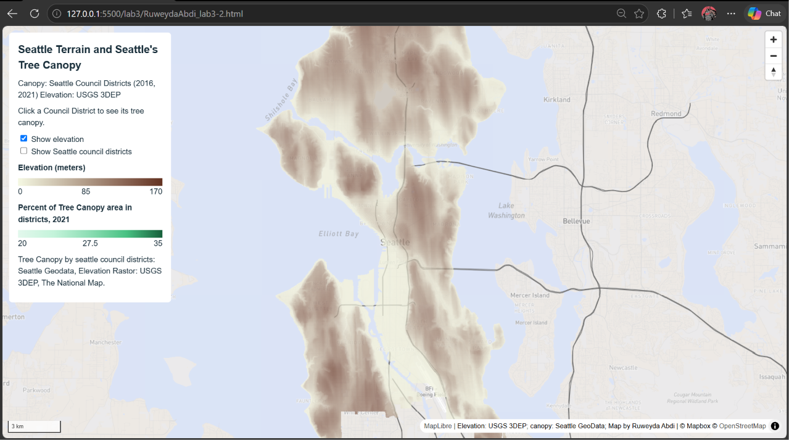
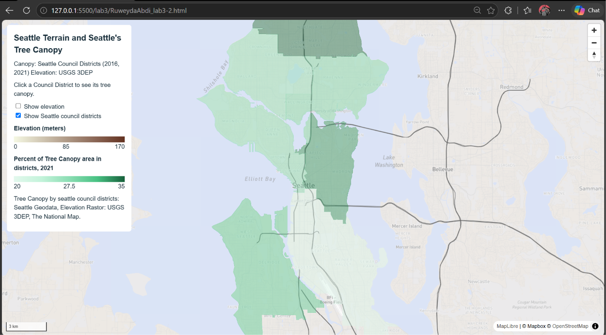
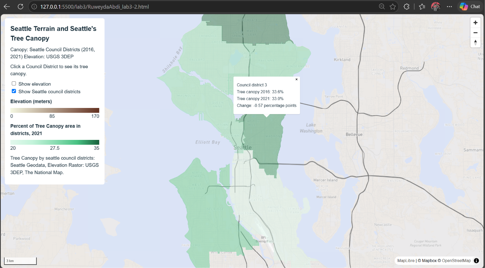

# Lab 3: Seattle Terrain and Tree Canopy 

# Purpose 
This map purpose is to display Seattle's terrain and tree canopy. This information may help educate people about where in seattle is covered by tree canopy. The Council district layer's purpose is to show the percent of each council district's that is covered by tree canopy. The elevation layer shows the hills, vs the flatter areas of seattle. Both of these informations could help urban planners further develop seattle by understanding what locations are best. This data is in the years 2016, and 2021. Showcasing what has changed in the 5 year span.

# Study area
The study area is Seattle, while still the extent stilll shows more of puget sound, its a basemap , and is not nessary other than showcasing all of seattle and the surrounding waters. 
The long and Lat of the extent: North: 47.8211, East: -122.0313, South: 47.4029, and West: -122.6244. 
Web : (EPSG:3857) Tiles: 256 x 256 PNG

# Sources
Maps: 
Data: Elevation: USGS 3D, The National Map
      Tree Canopy: Seattle GeoData, Tree Canopy 2016 and 2021 by Council districts
      Feilds: TreeCanopy_2016_Percent, TreeCanopy_2021_Percent, Change_Percent_AbsDiff
      Basemap: Mapbox studio Lab3RA_Light made using Light by OpenStreetMap Contributors.

# processing / exported zoom range
Basemap: Changed the guided version, map to exclude roads, changed RPG and published.
Made a bookmark for the study area, used that as an extent, by zooming to districts and added elevation data as rastor layer. Styled as single pseudocolor, linear and ranged from 0 - 170 metters changed sympology to distribute data equally and classify it in 5 catagories. clipped it to extent an exported it using plugin with QmetaTiles. 
Did similar with council districts, I exported it as a GeoJSON from website onto QGIS, changed sympology.
Exported zoom range: 10-13, and the tiles are 256 x 256 PNG

# estimates vs. measurements 
For the elevation layer, it is a raster model of terrain. In it's tiles its a picture and does not actually have a value. The canopy numbers aren't measurements at a point. The popup in the web page values don't come from the raster files. It comes from the GeoJSON file of council districts. 

# Screenshots:

